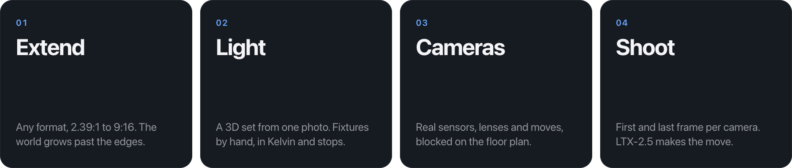
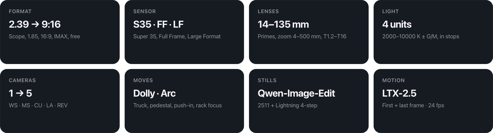

<p align="center">
  
</p>

<h1 align="center">EVE Tools for ComfyUI</h1>

<p align="center">
  <b>One photo. A whole film set.</b><br>
  Light it, place your cameras, roll.
</p>

<p align="center">
  
  
  
  
  
</p>

<p align="center">
  <a href="#run-it">Run it</a> · <a href="#workflows">Workflows</a> · <a href="https://cdn.jsdelivr.net/gh/kimagedon/eve-tools-for-comfyui@main/docs/media/demo.mp4">Watch the film</a>
</p>

<br>

<picture>
  <source media="(prefers-color-scheme: light)" srcset="docs/media/steps-light.png">
  
</picture>

<br>

<p align="center">
  
</p>

<br>

<picture>
  <source media="(prefers-color-scheme: light)" srcset="docs/media/oneset-light.png">
  
</picture>

<br>

## Spec

<picture>
  <source media="(prefers-color-scheme: light)" srcset="docs/media/spec2-light.png">
  
</picture>

<details>
<summary><b>Full spec</b></summary>

<br>

| | |
|---|---|
| **Formats** | 2.39 Scope · 2.76 · 2.00 · 1.85 · 16:9 · IMAX 1.90 / 1.43 · 3:2 · 4:3 · 1:1 · 9:16 · free — the shot follows the frame |
| **Sensors** | Super 35 · Full Frame · Large Format |
| **Lenses** | Primes 14–135 mm · zoom 4–500 mm · T1.2–T16 |
| **Light** | Up to 4 units · 2000–10000 K ± G/M · key:fill in stops |
| **Cameras** | 1 to start, up to 5 · WS · MS · CU · LA · REV |
| **Moves** | Dolly · Truck · Arc · Pedestal · Push-in · Rack focus |
| **Shots** | 4 s · 24 fps |
| **Stills** | Qwen-Image-Edit-2511 + Lightning 4-step LoRA |
| **Motion** | LTX-2.5 22B distilled |
| **Set** | MoGe-2 on WebGPU · Depth Anything V2 Small fallback |
| **Exports** | Cut (MP4) · takes · camera report (CSV) · lighting plot (SVG) · EDL |
</details>

Open weights only. Core ComfyUI nodes only — no custom node packs, no partner nodes, no closed APIs.

<p align="center">
  
</p>

## Run it

**1 · Start ComfyUI** with the models from [`scripts/models.md`](scripts/models.md) and CORS on:

```sh
python main.py --listen 0.0.0.0 --port 8188 --enable-cors-header "*"
```

**2 · Start the app:**

```sh
git clone https://github.com/kimagedon/eve-tools-for-comfyui
cd eve-tools-for-comfyui
npm ci && npm run dev        # → http://localhost:5173
```

**3 · Connect** — the status dot at the top right:

| | Where ComfyUI runs | What you enter |
|---|---|---|
| **Local** | Your own GPU · NVIDIA · 48 GB+ VRAM | nothing — `http://127.0.0.1:8188` |
| **Remote** | A rented GPU — RunPod, any cloud box | its URL, e.g. `https://<pod-id>-8188.proxy.runpod.net` |
| **Comfy Cloud** | Comfy's own servers | an API key in `.env` |

<details>
<summary><b>RunPod in one command</b></summary>

<br>

Start the official *ComfyUI* template (A100 / H100 80 GB, 200 GB volume), copy [`scripts/setup_pod.sh`](scripts/setup_pod.sh) to the pod:

```sh
HF_TOKEN=hf_... bash setup_pod.sh
```

It updates ComfyUI, downloads every model (resumable) and restarts it on `:8188` with CORS. LTX-2.5 is gated — accept its license on [Hugging Face](https://huggingface.co/Lightricks/LTX-2.5) first.
</details>

<details>
<summary><b>Comfy Cloud</b></summary>

<br>

Choose Comfy Cloud and paste your API key (platform.comfy.org → API Keys; needs an active Comfy Cloud subscription). The key stays in your browser. Comfy Cloud doesn't accept browser calls from other websites, so requests go through a thin relay that forwards your key and stores nothing: the local dev server's `/cloud` when you run `npm run dev`, and a public relay for the hosted page.
</details>

<details>
<summary><b>How it works</b></summary>

<br>

The browser does the geometry — depth, the 3D set, lights, cameras, guides, the cut. ComfyUI does the pixels. They talk over ComfyUI's standard API (`/upload/image`, `/prompt`, `/ws`, `/history`, `/view`); nothing to install on the server.

```
Extend    photo + mask          → Qwen-Image-Edit   → extended plate
Light     plate + lit 3D guide  → Qwen-Image-Edit   → lit plate
Shoot     guide (head, tail)    → Qwen-Image-Edit   → two stills
          two stills            → LTX-2.5 first/last frame → shot
```

Graphs: [`src/workflows.ts`](src/workflows.ts) · client: [`src/comfy.ts`](src/comfy.ts). Timings on one A100 80 GB: still 10–15 s · Extend ~30 s · shot ~70 s.
</details>

## Workflows

The graphs the app runs, ready to drop onto the ComfyUI canvas — [`workflows/`](workflows):

| | |
|---|---|
| `edit` | Qwen-Image-Edit-2511 + Lightning LoRA — Extend, Relight, every still |
| `shot-video` | LTX-2.5 first + last frame → 97 frames, 24 fps — every shot |
| `shot-video-i2v` | LTX-2.5 image-to-video with x2 upscale — single-key variant |

<details>
<summary><b>Honest limits</b></summary>

<br>

- One photo is not a scan. Within the lens' reach the guide is real geometry; a true reverse is invented, and the app says so.
- Distances are approximate (≈) — a single still has no absolute scale.
- Best depth needs WebGPU (Chrome, Edge, recent Safari).
- Small props can drift between setups; the shared set and light hold the big picture.
</details>

## License

Code [MIT](LICENSE). Qwen-Image-Edit-2511, Qwen2.5-VL, Lightning LoRA — Apache-2.0. LTX-2.5 — [LTX-2.x Community License](https://github.com/Lightricks/LTX-2/blob/main/LICENSE-2_x). MoGe-2 — MIT. Depth Anything V2 Small — Apache-2.0.
The sample stills in `examples/` are original images made for this project, used only as input photos.
